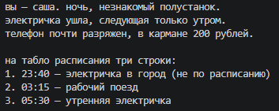
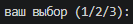
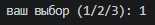
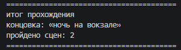
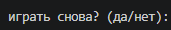

# последняя электричка

## о чём игра
вы - студент Саша, возвращаетесь домой после учёбы и застреваете ночью на незнакомом полустанке. следующая электричка только утром, телефон почти разряжен, в кармане последние 200 рублей. вы решаете, как добраться до дома: рискнуть остановить поезд не по расписанию, поискать ночлег рядом или ждать утреннюю электричку. от вашего выбора зависит, какой концовкой закончится история.

игра для студентов и всех, кому близка тема дороги домой, ночных приключений и решений с ограниченными ресурсами.

## как запустить
1. откройте финальную версию v1.0 — папка 
2. нажмите на кнопку пуска или введите в терминале 
```bash
python v1.0.py
```

## как играть
1. нажмите «начать новую игру» - откроется сцена 1 «у расписания».    
2. прочитайте текст сцены и нажмите «1,2,3», чтобы перейти к реплике.

3. выберите один из вариантов - от него зависит, какая сцена откроется следующей. 
4. дойдите до концовки и посмотрите экран итога прохождения. 
5. чтобы пройти другой путь, нажмите «играть снова».
 

## команда
- Аникин Олег -   разработка программы
- Писаренко Кирилл - документация , сценарий
- Белеков Нурэль -  презентация
- Быков Артем - тестировщик

## документация
- [устав проекта](docs01_устав_проекта.md)
- [план проекта](docs02_план_проекта.md)
- [требования](docs03_требования.md)
- [техническое задание](docs04_техническое_задание.md)
- [протокол встречи](docs05_протокол_встречи.md)
- [отчёт о статусе](docs06_отчёт_о_статусе.md)
- [документация продукта](docs07_документация_продукта.md)
- [отчёт о тестировании](testsotchet.md)
- [история изменений](changelog.md)